
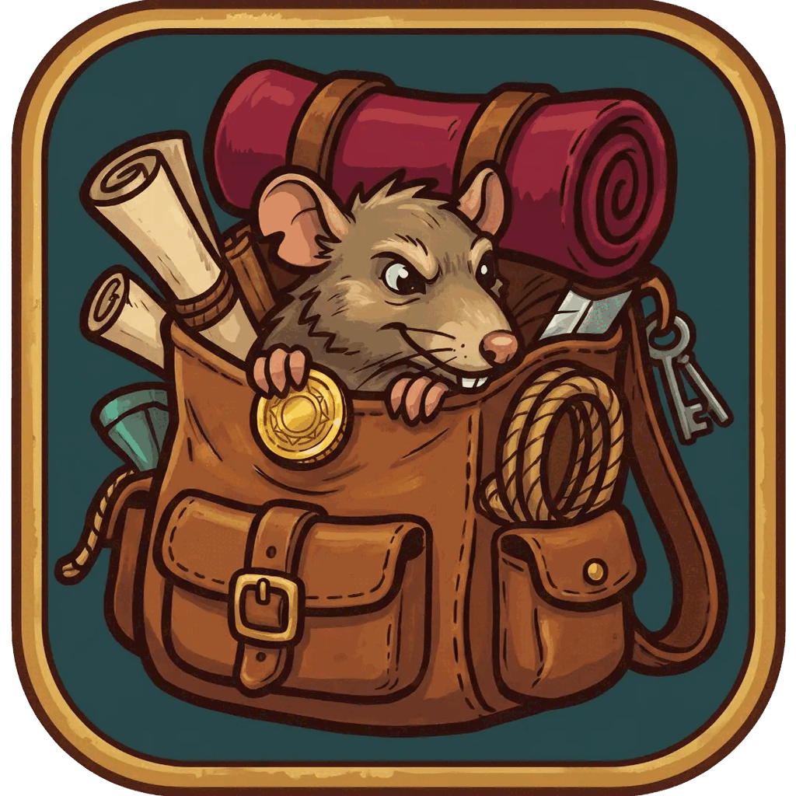

<h1 align="center">Pack Rat</h1>

<b>Know everything you own in Ultima Online, and wear the best of it.</b>

Pack Rat is a free desktop app for Ultima Online players. It keeps a list of every item on every character, in every bag, chest and bank box, and works out the best suit of gear you can make from them. It reads your gear through small scripts you run in your own game client, and everything stays on your computer.

Made for [UO Alive](https://uoalive.com). It may work on other shards, but it hasn't been tested on them yet.

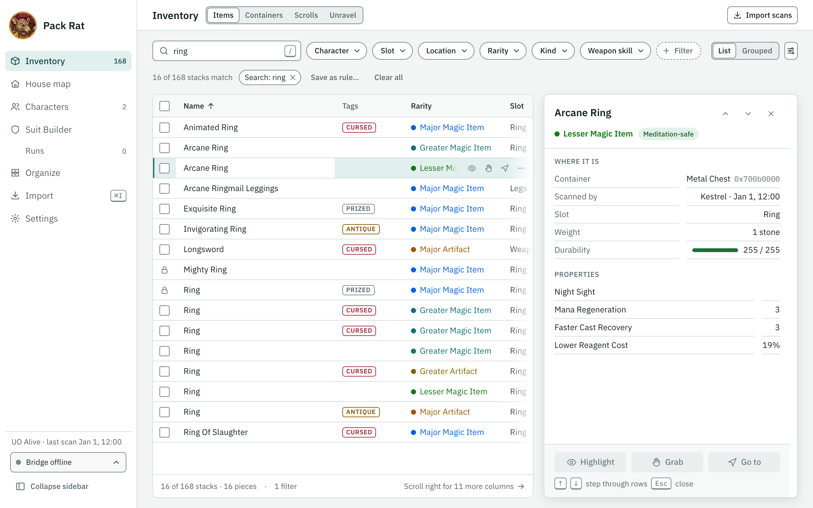

<a href="https://github.com/gunn4r/uo-pack-rat/releases"><b>Download Pack Rat</b></a> for Mac, Windows or Linux · <a href="docs/user-guide.md">User guide</a>

## What it does

### Find anything you own

Search every character's gear, bags, chests and bank in one table, each piece with its in-game icon and its name in its rarity's color. Narrow it by property (at least, at most, exactly or not), type, slot, slayer, house or Organize label. Click an item to see its properties and where it is. With the in-game bridge running, **Highlight** marks it in game, **Go to** walks you to its chest, and **Grab** puts it in your backpack.

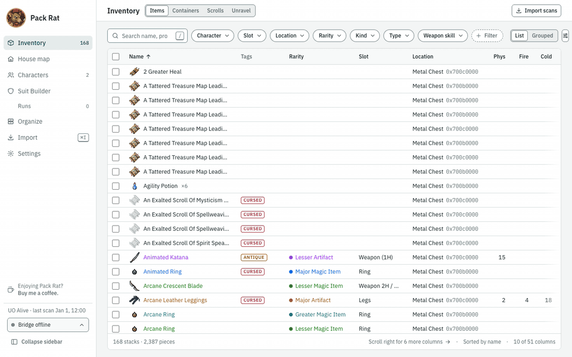

### See each character at a glance

A character sheet with your character's paperdoll in the gear they wear, resists, stats and every property against the shard's cap.

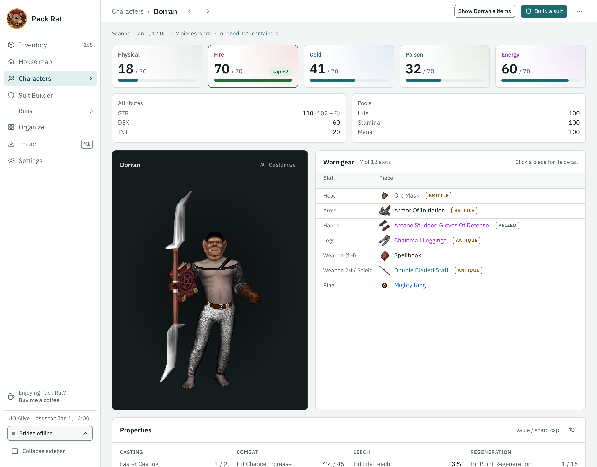

### Build your best suit

Pick a template such as Melee, Caster or Tank, or set your own goals, and the Suit Builder searches everything you own for the best suit. It plans around the buffs you fight with, shows your character in what they wear now beside the new suit, and keeps runs you can compare. You can also build a suit by hand on a live paperdoll and let it fill the gaps.

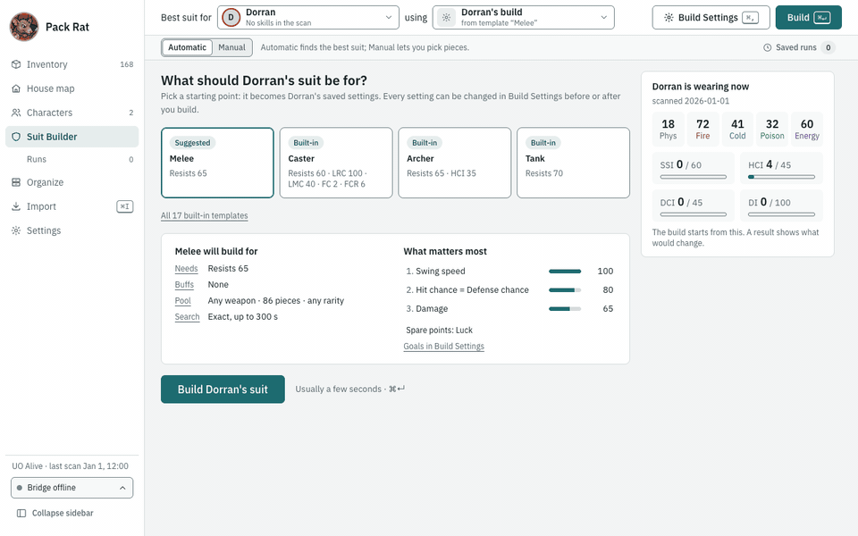

### Map your house

The House map draws your house from the game, with every chest stack colored by its label or by how full it is. Search it to see which chests hold what you're after.

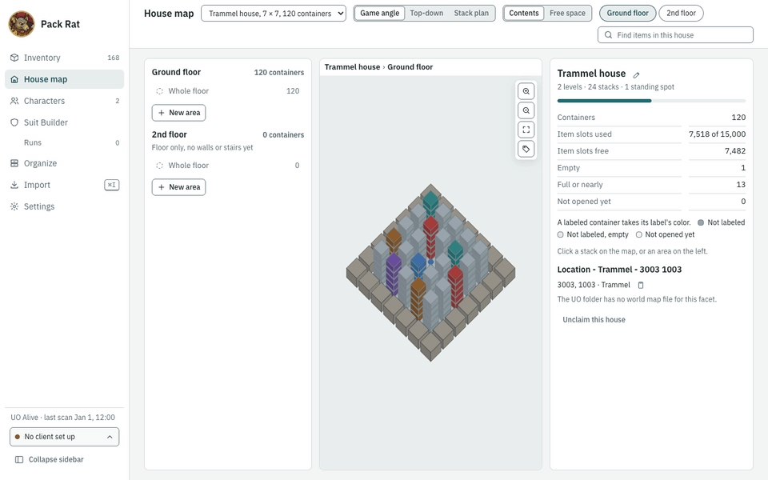

### Organize your storage

Give every item a home. **Auto organize** labels your chests and writes the sorting rules for you (simple, detailed or by build), shows the plan before anything moves, and with TazUO carries out the trips in game while you watch. **Put away** on the in-game panel files the loot you bring home.

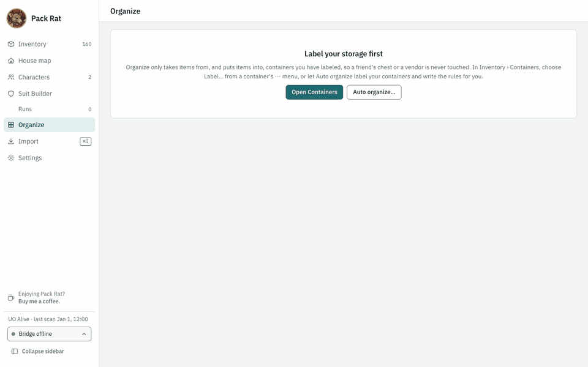

### Decide what to unravel

The Unravel view lists the pieces worth unraveling for imbuing ingredients, grouped by what each gives at your Imbuing skill, with a forecast of how much you'd get.

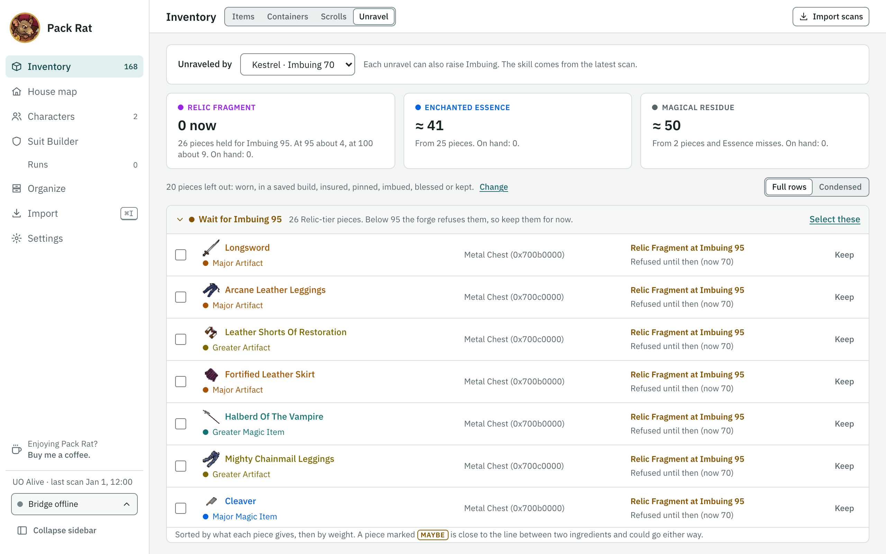

### Ask an AI assistant

Turn on **Settings › AI assistants (MCP)** and Claude Code, or another MCP client, can search your inventory and run the Suit Builder for you: "what's my best LRC ring?". See [docs/mcp.md](docs/mcp.md).

## How it works with the game

Pack Rat's scripts run inside your game client. The scanner reads your gear, and the bridge carries out what you ask for in the app, such as a Grab or an Organize trip. The in-game panel starts both. More in [The game scripts](docs/user-guide.md#the-game-scripts).

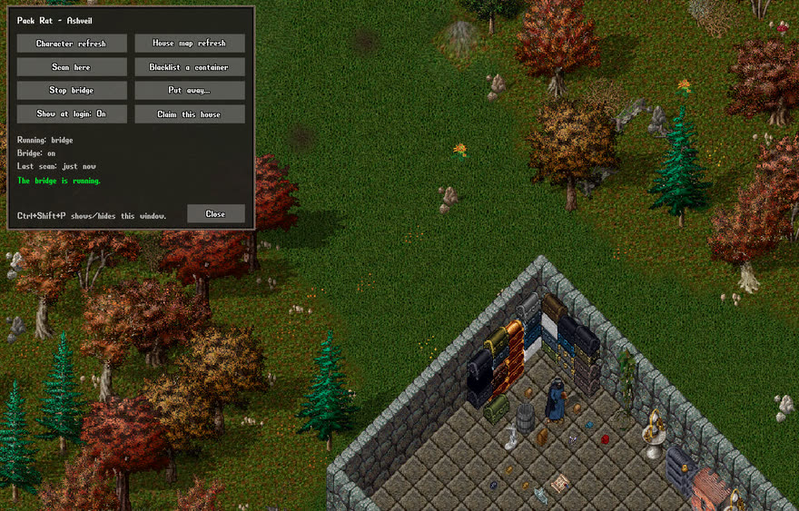

<table><tr>
<td>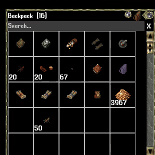</td>
<td>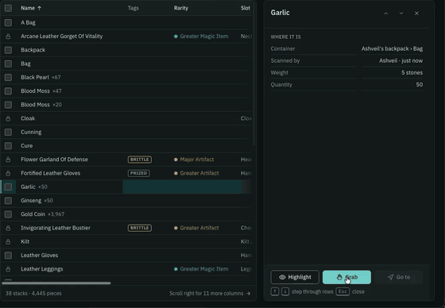</td>
</tr></table>

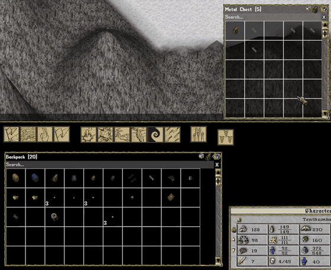

## Get started

1. **Download** the file for your computer from the [Releases page](https://github.com/gunn4r/uo-pack-rat/releases): the `.dmg` for a Mac (`arm64` for Apple chips, `x64` for Intel), the `.exe` for Windows, or the `.AppImage` for Linux.
2. **Open it.** Pack Rat isn't code-signed, so the first launch shows a warning. On a Mac, right-click the app in Applications and choose **Open**. On Windows, click **More info**, then **Run anyway**. The [user guide](docs/user-guide.md#install) has the details, including the "is damaged" fix on a Mac.
3. **Follow the setup window.** Pick your shard (UO Alive, or a generic rule set for any other) and your game client (**TazUO**, **Razor Enhanced** or the **ClassicUO web client**), and Pack Rat installs its scripts in your client's folder. More in [First run](docs/user-guide.md#first-run).
4. **Scan in game.** Stand next to your chests and run `packrat-scanner.py`. Your items show up in Pack Rat within a few seconds.

TazUO needs v26.0923.64 or later. The [user guide](docs/user-guide.md#the-game-scripts) lists every script and when to run it.

## Updating

Pack Rat tells you when a new version is out; nothing installs on its own. Download it from the Releases page, install it over the old one, then reinstall the game scripts from **Settings**. [More on updating](docs/user-guide.md#updating).

## Your data and privacy

Everything stays in one folder on your computer. The only thing Pack Rat sends anywhere is the update check, which asks GitHub for the latest version number. The scripts only read what your character can see, never fight, gather or loot, and only move an item when you ask. A scan file shows where your house is, so look before you share one. See [PRIVACY.md](PRIVACY.md) and [where your data lives](docs/user-guide.md#your-data-folder).

## Verifying a download

Optional. Each release has a `SHA256SUMS` file for checking that a download is exactly the file this project published. The steps are in [RELEASING.md](RELEASING.md#verifying-a-download).

## Help

Something not working? Start with [Troubleshooting](docs/user-guide.md#troubleshooting). Questions and ideas go in [Discussions](https://github.com/gunn4r/uo-pack-rat/discussions), bugs in [Issues](https://github.com/gunn4r/uo-pack-rat/issues). Don't attach a scan file without reading it first.

## Contributing

See [CONTRIBUTING.md](CONTRIBUTING.md) for running from source, the tests and the architecture, and [SECURITY.md](SECURITY.md) for reporting a security problem.

## Support

If Pack Rat saves you time, you can buy me a coffee.

## License

MIT, see `LICENSE`. The bundled IBM Plex Sans and IBM Plex Mono fonts (`app/ui/fonts/`) are © IBM Corp., and the Cinzel font the Britannia theme uses is © The Cinzel Project Authors, all under the SIL Open Font License 1.1; their license texts sit next to them. The Britannia theme's frames and textures are drawn by the app itself; it uses no art from any game or game client.

## Disclaimer

Pack Rat is an independent hobby project. It is not affiliated with or endorsed by Electronic Arts, Broadsword Online Games, UO Alive, or the TazUO, Razor Enhanced or ClassicUO projects. Ultima Online is a trademark of Electronic Arts Inc., and all other trademarks belong to their owners.
