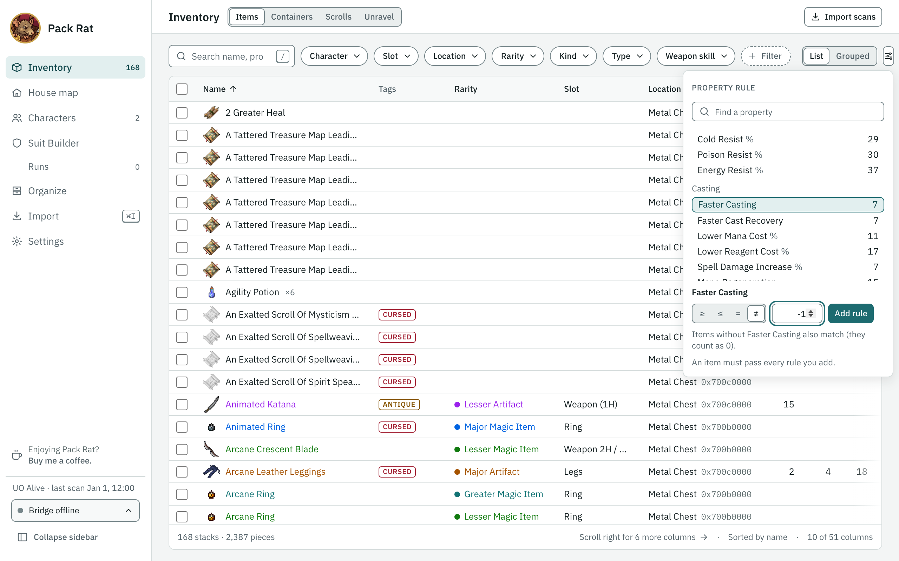
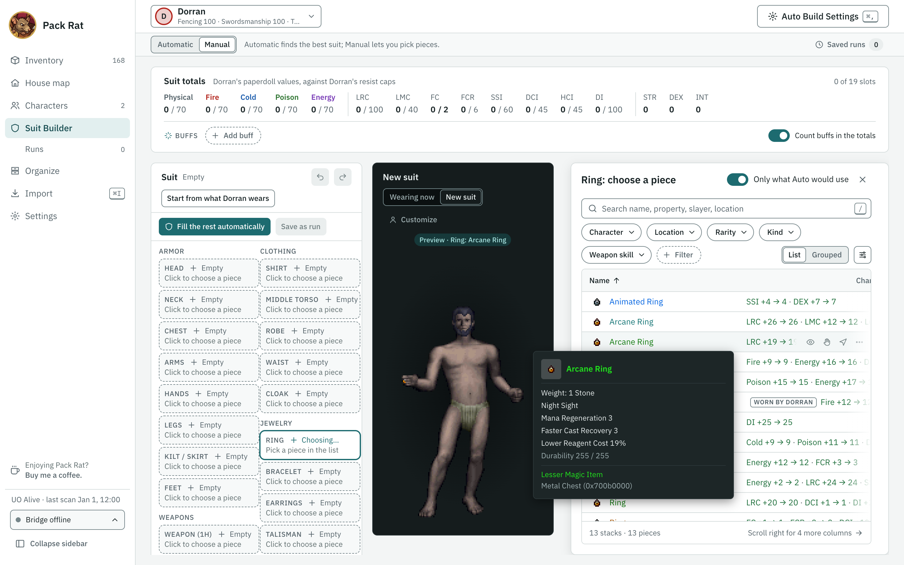
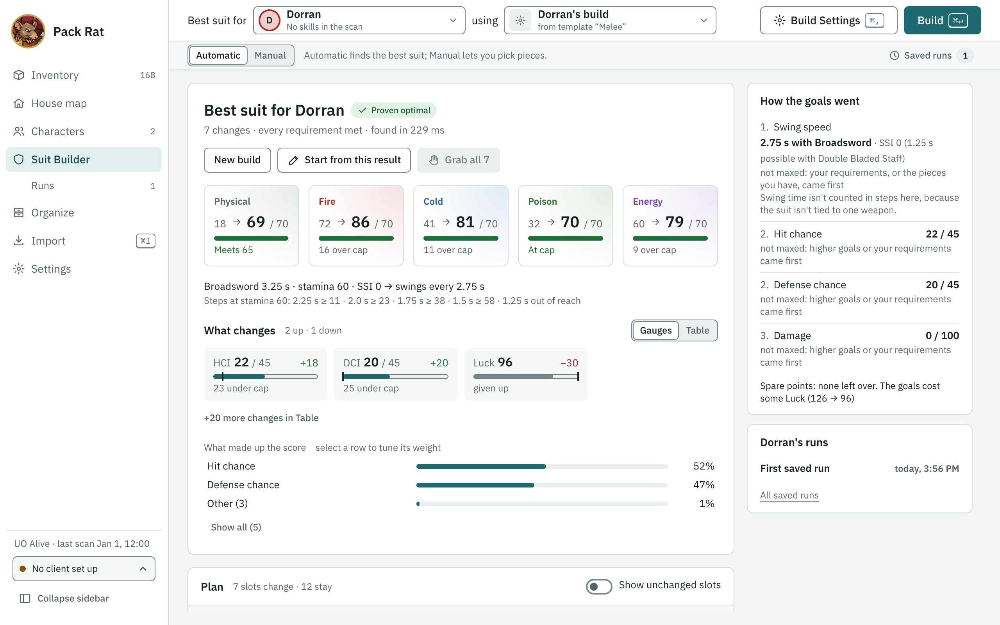
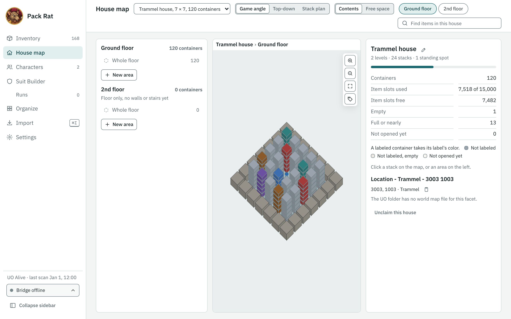
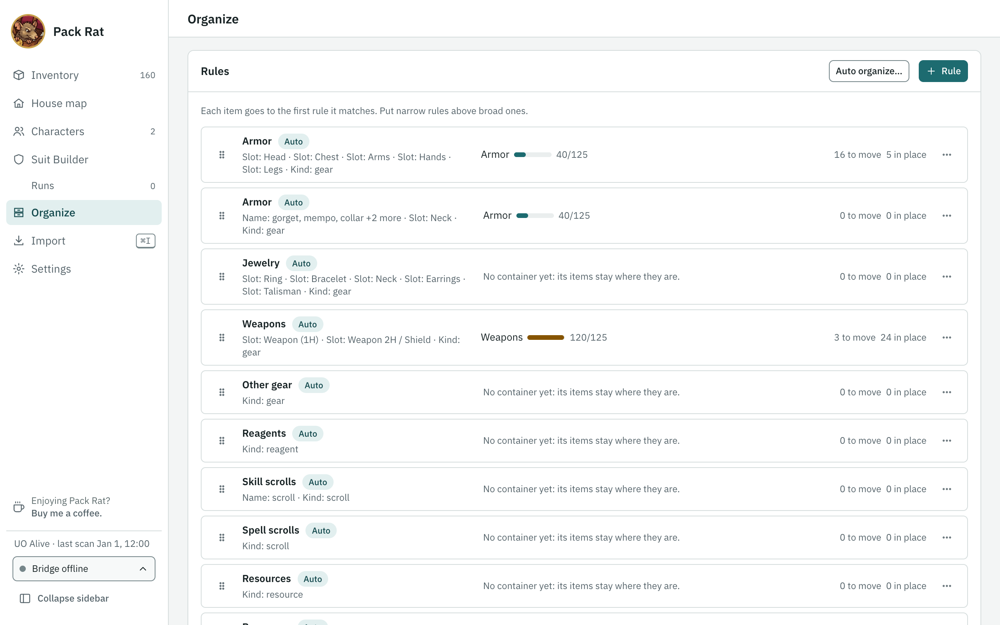
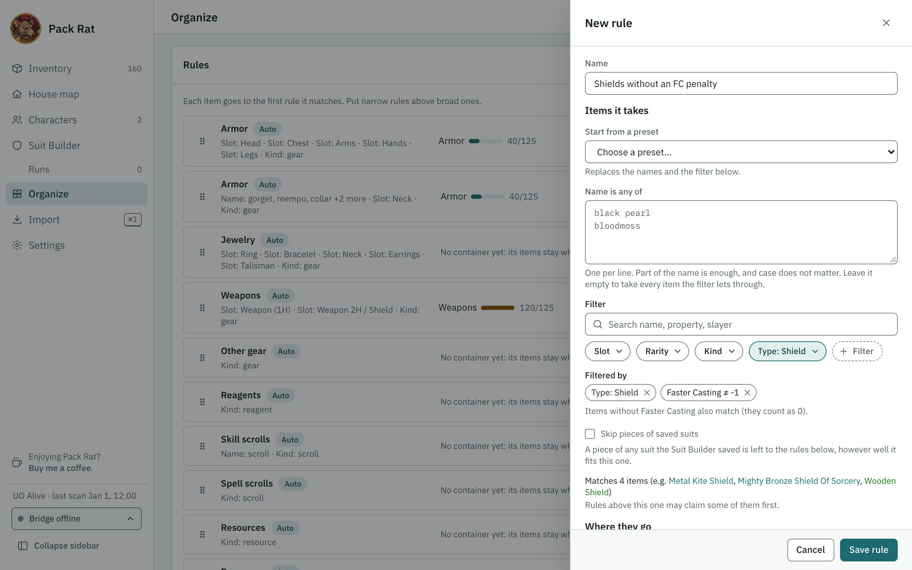

# Pack Rat user guide

Everything about using Pack Rat, in more detail than the [README](../README.md). Jump to what you need:

- [Install](#install)
- [First run](#first-run)
- [The game scripts](#the-game-scripts)
- [Inventory and characters](#inventory-and-characters)
- [Suit Builder](#suit-builder)
- [House map](#house-map)
- [Organize](#organize)
- [The ClassicUO web client](#the-classicuo-web-client)
- [AI assistants (MCP)](#ai-assistants-mcp)
- [Play attended](#play-attended)
- [Updating](#updating)
- [Your data folder](#your-data-folder)
- [Troubleshooting](#troubleshooting)

## Install

Go to the [Releases page](https://github.com/gunn4r/uo-pack-rat/releases) and, under the latest release, download the file for your computer:

| Your computer | File |
|---|---|
| Mac with an Apple chip (M1, M2, M3, M4…) | `PackRat-<version>-mac-arm64.dmg` |
| Mac with an Intel chip | `PackRat-<version>-mac-x64.dmg` |
| Windows (installer) | `PackRat-<version>-win-x64.exe` |
| Windows (no install) | `PackRat-<version>-portable-win-x64.exe` |
| Linux | `PackRat-<version>-linux-x86_64.AppImage` |

Not sure which Mac you have? Apple menu › **About This Mac**: **Chip: Apple M…** means the Apple chip file, **Processor: … Intel …** the Intel one. Each Mac build also comes as a `.zip` if you'd rather drag the app into Applications yourself.

Pack Rat is not code-signed (signing is a paid certificate that tells your computer who made an app), so the first launch shows a warning. That is expected.

### Mac

Open the `.dmg` and drag **Pack Rat** into **Applications**. In Applications, right-click **Pack Rat** and choose **Open**, then **Open** again; you only do this once. If there is no **Open** button, go to **System Settings › Privacy & Security** and click **Open Anyway**.

If macOS says the app **"is damaged and can't be opened"**, that is how it describes an unsigned download. Run this in Terminal, then open it again:

```
xattr -dr com.apple.quarantine "/Applications/Pack Rat.app"
```

macOS may also ask whether Pack Rat can access your Desktop or another folder. That is Pack Rat reading your game client's folder (for example TazUO kept on the Desktop) to install and update its scripts; allow it.

### Windows

Run the installer. If **"Windows protected your PC"** appears, click **More info**, then **Run anyway**. The portable `.exe` runs without installing and shows the same warning.

### Linux

Make the AppImage executable, then run it:

```
chmod +x PackRat-<version>-linux-x86_64.AppImage
./PackRat-<version>-linux-x86_64.AppImage
```

## First run

The first time Pack Rat opens, a setup window walks you through four steps:

1. **Shard.** Pick the shard you play on.
2. **Client.** Pick your game client: **TazUO**, **Razor Enhanced** (Windows only) or the **ClassicUO web client** (the one you play in a browser).
3. **Client folder.** Pick the folder your client is installed in. Pack Rat finds TazUO on its own when it can; otherwise click **Choose a folder…** (for TazUO, the `TazUO` folder or the `LegionScripts` folder inside it; for Razor Enhanced, the folder `Razor.exe` is in).
4. **Install scanner.** If the game is running, stop any running Pack Rat scripts first, so none is replaced while it runs (TazUO: type `-stopall` in the game's chat; Razor Enhanced: press Stop on each in its Scripting tab). Check the box that says you did, click **Install scanner**, then **Finish**. The last screen lists what to press in game, and when.

The ClassicUO web client can't save files, so there is nothing to install for it: step 3 gives you a **Copy scanner script** button instead (see [The ClassicUO web client](#the-classicuo-web-client)).

**Set up later** is always safe. You can run setup again from **Settings › Run setup**.

TazUO scripts require **TazUO v26.0923.64 or later**; update TazUO from its launcher if yours is older.

## The game scripts

The setup window puts these scripts in your client's scripts folder (which ones depends on the client):

- **`packrat-scanner.py`**: the full scan. It reads what you wear, your backpack, and every chest and bag within 2 tiles, including bags inside them. A chest 3 tiles away is read only if your client already shows its contents, since the game won't open it from there. With your bank box open it reads the bank instead of nearby chests. Trash barrels and chests are skipped.
- **`packrat-character-refresh.py`**: a quick refresh of your stats, skills, worn gear and backpack. It takes a few seconds and works anywhere.
- **`packrat-house-map-refresh.py`** (TazUO only): records just the house you stand in for the **House map**: its floors and walls, furniture and where every chest stands. It opens nothing and leaves the inventory as it was.
- **`packrat-bridge.py`**: makes the app's **Highlight**, **Grab** and **Go to** buttons work. Start it and leave it running; it stops on its own after 8 hours.
- **`packrat-blacklist.py`**: click a chest or bag and scans never open it again, such as a guild chest. You can also blacklist a container from the app's **Containers** view.
- **`packrat-panel.py`** (TazUO only): the in-game Pack Rat panel, a small window with buttons for all of the above and Organize's **Put away**. It starts with TazUO; **Ctrl+Shift+P** shows or hides it, and you can change that hotkey in **Settings**.

In TazUO, start a script from the in-game panel, or from the Script Manager (**Legion Script** in TazUO's top menu) with its **Play** button. In Razor Enhanced (Windows only), add the Pack Rat scripts on the **Scripts** tab and start them like any other script; it has every script but the in-game panel. More in [adapters/razor-enhanced/README.md](../adapters/razor-enhanced/README.md) and [adapters/tazuo/README.md](../adapters/tazuo/README.md).

### When to run what

- **First time on a character, or when your chests change:** stand next to a group of chests and run the scanner; repeat at each group. For your bank, open the bank box and run it there.
- **After gearing up or training:** run the character refresh.
- **After moving furniture or chests around your house (TazUO):** stand inside it and run the house map refresh.
- **To find or fetch an item:** start the bridge, then use the buttons on the item in **Inventory** or **Suit Builder**.

Scans show up in **Inventory** within a few seconds; you don't have to press anything in the app.

## Inventory and characters

**Inventory** is one table of everything you own, each piece with its in-game icon and its name in its rarity's color (both drawn from your own client files). Search by name, property, tag, slayer, location or a container's Organize label, and narrow it with the filters:

- **Location** lists each character's backpack and bank, then your houses (from the House map) with their containers, a labeled container by its label.
- **Type** keeps shields, two- or one-handed weapons, spellbooks, armor, jewelry or clothing.
- **+ Filter › Property rule** picks any gear property by its shard name, with how many items in view carry it, and keeps items with at least, at most, exactly or anything but a value. An item without the property counts as 0, and the rule says so when that lets such items through ("Faster Casting ≠ -1" also keeps every reagent).



Click a row to see the item's properties and where it is.

With the bridge running, **Highlight** marks an item and its container in game, **Go to** walks you to its chest, and **Grab** walks there and puts it in your backpack. To find a chest itself, use **Highlight in game** in its ⋯ menu under Inventory › Containers; that list has its own search and Kind and House filters.

**Characters** shows each character's sheet: their paperdoll in the gear they wear, the worn pieces (click one for its detail), resists, stats and every property against the shard's cap. **Customize** tries another look on the figure. The paperdoll is drawn from your own client files (Pack Rat reads the 7.x files; **Settings › Game client** shows the UO folder it uses) and needs a TazUO scan made with the current scripts; otherwise it shows a gray stand-in and says why.

The Inventory's **Unravel** view lists the pieces worth unraveling for imbuing ingredients, grouped by what each gives at your character's Imbuing skill, with a forecast of how much you'd get.

Pick the **Britannia** theme in **Settings › Theme** for parchment, brass frames and a dark-wood night mode.

## Suit Builder

**Suit Builder** finds the best suit for a character from everything you own, with the stats, floors and caps you care about, and keeps saved runs you can reopen and compare. Start from a template (Melee, Caster, Archer, Tank and more), or tune the goals in **Auto Build Settings**.

Turn on the buffs and forms you fight with (Divine Fury, Reaper Form, Bless, potions…) and the search plans around them, so gear only supplies what they don't.

A result shows your character twice, in what they wear now and in the new suit, with **Customize** for both.

**Manual** lets you build a suit by hand on a live paperdoll and see its totals, buffs included. Hover or arrow through the picker's rows to preview a piece on the figure, and turn on **Only what Auto would use** to list just the pieces an automatic build may pick. Then let the search fill the slots you left empty (with the settings in **Auto Build Settings**, which Manual opens too), save it as a run, or start from an automatic result.





## House map

The **House map** draws your house from the game, floor by floor, with every stack of chests where it stands. To add a house, stand inside it in game, press **Claim this house** in the Pack Rat panel, then run the house map refresh (TazUO). The map needs your UO folder's `tiledata.mul`; **Settings** shows where Pack Rat found it.



Switch between **Game angle**, **Top-down** and **Stack plan** (a list of every stack, grouped by area, top chest first), and color the chests by their **Contents** (a labeled chest takes its label's color) or by **Free space**. **Find items in this house** marks the chests that hold what you search for. **New area** draws named areas on a floor, such as a room or a row of chests. Click a stack to see its chests, label one, highlight it in game or open its contents.

## Organize

Organize gives every item in your house a home.



### Rules

Label the chests that are yours (Inventory › Containers, ⋯ › Label…), then add rules on the **Organize** screen. Start from a preset such as Magery reagents or Rings, or save the Inventory's current filters as a rule. The rule's filters are the Inventory's own (search, slot, type, kind, rarity, property rules, slayer, tags), without character, location or seen, so a rule keeps matching an item after it moves. Pick the containers each rule fills, in order: your labeled chests, or a bag inside one. While you edit a rule it says how many of your items it matches.



Items go to the first rule they match; anything no rule takes stays put, or goes to the container you pick for everything else.

For gear you never want (imbuing fodder, say), put a rule at the top that sends it to a fodder chest. The presets Splintering weapons and Splintering and brittle are a start, a property filter can set a threshold on lines such as Splintering Weapon, a tag filter can require Brittle, Cursed, Antique or Prized, and **Skip pieces of saved suits** keeps any piece of a Suit Builder run you saved out of it.

### Auto organize

**Auto organize** does the setting up for you. Press **Auto organize…** on the Organize screen and choose a strategy:

- **Simple:** one container for each kind of thing: armor, weapons, spellbooks, jewelry, reagents, skill scrolls, spell scrolls, treasure maps and SOS, resources with the refinements, tools with the instruments and crafting tools, decor, quest and event items, and so on.
- **Detailed:** armor by slot, reagents by school, power scrolls by level, spell scrolls by school, resources by type, crafting tools apart from the other tools.
- **By build:** gear sorted into Caster, Melee, Hybrid, Tank and Other gear by its properties (a spellbook with none counts as Caster), everything else as in Simple.

Then check the chests it may use. It gives each group the chest that already holds most of it, adds more chests when a group is too big for one, and lets the small groups of one kind share a chest when there are fewer chests than groups, each in an empty bag of its own there.

It shows the proposal before anything is saved: which chest (or bag) each group gets, what does not fit, how many items will move, and what to add for the full layout (no chest over 80% full, so loot has room, and a bag for each group that shares one): "add 1 more chest and 8 bags: 5 in the Armor chest…". Add them, rescan and run it again, or accept what fits now.

**Accept** labels the checked chests and writes ordinary rules marked Auto, which you can edit like any other (an edited rule is yours from then on). Your own rules stay above Auto's, your own labels are never renamed, and running Auto organize again on a house it has already sorted changes nothing.

### Classify what Pack Rat gets wrong

Every item that is not gear has a kind (reagent, scroll, decor, tool…), and what Pack Rat cannot place is Other, which Organize can only file as one lump. **Review unclassified items**, beside the container for everything else on the Organize screen (and in the ⋯ menu of Auto organize's Other rule), lists them in Inventory.

**Classify this…** in an item's ⋯ menu gives it a kind for every item with its name, or for every item that looks the same (its graphic). The inventory and the plan change at once, no rescan needed; **Reset to automatic** undoes it. Your kinds are kept in `item-kinds.json` in the data folder; **Settings › Data › Item kinds you set** exports them to share, and imports someone else's on top of yours. Gear always keeps its own kind.

### The plan and its trips

Pack Rat shows the plan before anything moves: what does not fit and how many slots are missing, what belongs at another house, and the trips, with about how long they will take.

With the TazUO client, **Run trip** carries one trip out in game while you watch, moving an item straight from chest to chest when the two stand close enough to reach both from one spot (**Run all** goes on trip by trip, **Stop** halts after the current step). With other clients the plan tells you what to move by hand.

Only labeled containers are ever touched, a pinned container is never emptied or filled, and an item the server refuses to move can be pinned where it is. The plan also warns when a rule's container will be over 90% full after the trips, so you can add another before the next loot run. It lists the empty bags left in your labeled chests (each still takes one of the chest's 125 item slots); pick a container for **Empty bags** under the rules and the trips gather them there. Nothing is ever thrown away.

Organize reads each container's fill from its tooltip. If the plan says a container's fill is unknown, or that it was scanned with older scripts, reinstall the scripts (**Settings › Game client › Reinstall**) and rescan your house.

### Put away

**Put away** files what you bring home without the app window. Once the house is sorted, press **Put away...** on the in-game Pack Rat panel (TazUO) and click a container: your backpack, a bag of loot in it, or a chest you labeled (stand next to it). Pack Rat reads that container and puts each item lying directly in it into the chest its rule names, in the house you stand in, trip after trip, until nothing is left.

Bags inside the container you picked stay, with everything in them, so the potions and reagents you keep in a pouch stay with you; to put away a bag's contents, press Put away... again and click that bag. Everything else in it goes, insured gear included, so put into that container only what you want filed. Pinned items stay, items for another house stay where they are, and nothing else in the house moves.

The app must be running and the bridge started. The panel says how many items went where they belong, and what stayed and why, and its button reads **Cancel put away** while a run goes on.

## The ClassicUO web client

Click **Copy scanner script** (in setup, or later in **Settings › Game client**, which also says when a newer scanner ships) and paste it into the web client's scripting window as a new script; run it near what you want scanned. Copy the block it prints (from `-----BEGIN PACK RAT SCAN-----` to `-----END PACK RAT SCAN-----`), open **Import** in Pack Rat (⌘I, or Ctrl+I on Windows and Linux) and paste it.

The web client can't see your bank box and has no bridge, so Highlight, Grab and Go to don't work for it. More in [adapters/classicuo-web/README.md](../adapters/classicuo-web/README.md).

## AI assistants (MCP)

Turn on **Settings › AI assistants (MCP)** and Claude Code (or another MCP client) can search your inventory, read character sheets and saved runs, and run the Suit Builder for you: "what's my best LRC ring?", "build Kestrel a 70-resist suit with Divine Fury on". **Copy command** gives a one-line `claude mcp add …` to run once.

A second switch, **Allow in-game actions**, also lets it Highlight, Go to, Grab, start a scan and run Organize trips. What the client reads, it may send to its own AI provider. [docs/mcp.md](mcp.md) has the tools and the details.

## Play attended

The scripts only read what your character can see, and only move an item when you click a button in the app, or when an AI assistant you've allowed in-game actions asks. They never fight, gather or loot, and they don't keep acting while you are away. Most shards ban unattended fighting, gathering and looting, sometimes harshly; check your own shard's rules before running any script.

The Razor Enhanced and ClassicUO web client scripts have not been tried against a live game yet. If something goes wrong, please [open an issue](https://github.com/gunn4r/uo-pack-rat/issues).

## Updating

Pack Rat checks for a newer release shortly after it opens and every 6 hours while it stays open, and shows a notice with a **View release** link when there is one. Nothing downloads or installs on its own: download the new version from the Releases page and install it over the old one. You can check by hand, or turn the automatic check off, in **Settings › Updates**.

After updating the app, update the game scripts too: stop any running Pack Rat scripts (TazUO: `-stopall`; Razor Enhanced: Stop in its Scripting tab), then in **Settings** click **Reinstall** under **Reinstall scanner scripts**.

## Your data folder

Everything Pack Rat knows lives in one folder on your computer (**Settings › Data** has an **Open** button). Back it up by copying the folder; deleting it deletes everything. Only one Pack Rat can run on a data folder at a time.

| Computer | Folder |
|---|---|
| Mac | `~/Library/Application Support/Pack Rat` |
| Windows | `%APPDATA%\Pack Rat` |
| Linux | `~/.config/Pack Rat` |

The app sends nothing anywhere except the update check, which asks GitHub for the latest version number. An MCP client you connect reads what it asks for, and what it does with that is up to it. A scan file lists everything a character owns and where your scanned chests are, which usually means where your house is, so look before you post one in public. [PRIVACY.md](../PRIVACY.md) has the details.

## Troubleshooting

- **The setup window can't find my client folder.** Click **Choose a folder…** and pick it by hand; if Pack Rat says the folder isn't right, try one level up or down.
- **I ran the scanner but nothing showed up.** Check **Settings**: the client should show as installed. If you moved your game client, click **Run setup** again. A scan file Pack Rat can't read is put aside in a `rejected` folder in the data folder, with a note saying why.
- **Pack Rat says my game scripts write to another folder.** Stop any running Pack Rat scripts and reinstall the scripts from **Settings**; they will then write to the folder Pack Rat reads.
- **Pack Rat says a script is still running.** Stop it, then try again. TazUO: type `-stopall` in the game's chat and wait for **"No scripts are currently running"**. Razor Enhanced: in its Scripting tab, select each running Pack Rat script and press Stop.
- **The buttons say the bridge is offline.** Start `packrat-bridge.py` in game and wait until the app shows **Bridge ready** with your character's name.
- **The paperdoll is a gray stand-in.** Reinstall the scripts from **Settings** and rescan with TazUO, which records your character's look. If it says it can't find or read your client files, choose your UO folder in **Settings › Game client**.
- **A chest didn't get scanned.** The scanner only reads chests close to you that it can open; stand closer and run it again. A container that won't open keeps what was last scanned in it.

Questions and ideas: [Discussions](https://github.com/gunn4r/uo-pack-rat/discussions). Bugs: [Issues](https://github.com/gunn4r/uo-pack-rat/issues). Describe what you did and what you saw, and don't attach a scan file without reading it first.
